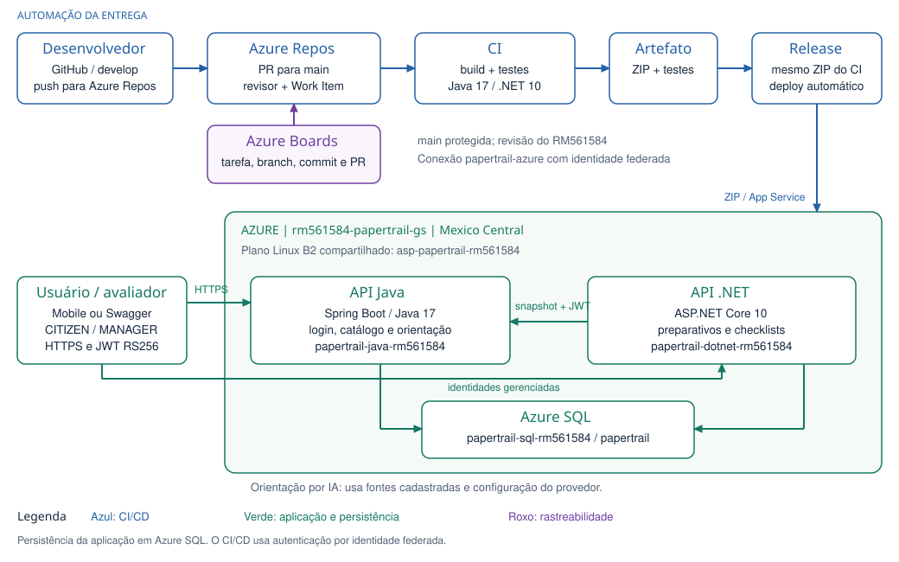

# PaperTrail .NET

O PaperTrail é um projeto CitizenTech da Global Solution da FIAP voltado à preparação para atendimentos em serviços públicos. A aplicação reúne requisitos e orientações sobre os serviços para que o cidadão organize o que precisa antes do atendimento.

Este repositório contém a API .NET, responsável pelos preparativos do cidadão. Cada preparativo guarda uma cópia dos requisitos de um serviço do catálogo Java, junto com a versão consultada na criação. A autenticação fica no Java; o .NET valida o token do login e restringe o acesso aos preparativos do próprio usuário.

## Aplicação publicada

- Swagger .NET: <https://papertrail-dotnet-rm561584.azurewebsites.net/swagger>
- Swagger Java: <https://papertrail-java-rm561584.azurewebsites.net/swagger-ui/index.html>

Para testar a aplicação publicada, faça o cadastro e o login pelo Swagger Java. Depois, informe o token retornado no botão **Authorize** do Swagger .NET.

As duas APIs publicadas usam o mesmo banco Azure SQL, com autenticação por identidade gerenciada. Para testar pelos links acima, basta criar uma conta na aplicação; não é necessário configurar um banco local. Os serviços e requisitos da carga inicial são fictícios.

## Execução local

O projeto usa .NET 10. Execute os comandos abaixo no Git Bash, dentro do repositório. Se o SDK estiver instalado em `$HOME/.dotnet`, inclua esse diretório no PATH:

```bash
export PATH="$HOME/.dotnet:$PATH"
dotnet --version
```

### Banco de dados

O caminho principal usa SQL Server. Prepare um banco próprio e execute [scripts/script-bd.sql](scripts/script-bd.sql) uma vez, em um banco vazio. Se o Java já usa esse banco, utilize a instalação existente. As duas APIs precisam consultar a mesma base.

O Azure SQL publicado usa identidade gerenciada do App Service, que não está disponível na máquina local. O acesso direto a esse banco exige uma identidade autorizada e a liberação da conexão. As credenciais do banco não são necessárias para usar as APIs publicadas.

Para um SQL Server próprio com usuário e senha, use este formato:

```text
Server=tcp:seu_servidor,1433;Database=papertrail;User Id=seu_usuario;Password=sua_senha;Encrypt=True;TrustServerCertificate=False
```

Selecione SQL Server e informe a conexão:

```bash
export Database__Provider=SqlServer
read -r -s -p "SQL Server connection string: " ConnectionStrings__PaperTrailSqlServer
export ConnectionStrings__PaperTrailSqlServer
```

<details>
<summary>Alternativa: executar com Oracle da FIAP</summary>

Quem tem uma conta válida na FIAP e não dispõe de um SQL Server próprio pode usar o Oracle. Execute [docs/database/papertrail.sql](docs/database/papertrail.sql) no SQL Developer com F5, uma vez por schema. Se o Java já usa as tabelas dessa conta, mantenha a instalação existente e configure as duas APIs para Oracle.

Use este formato para a conexão:

```text
User Id=seu_usuario;Password=sua_senha;Data Source=//oracle.fiap.com.br:1521/ORCL
```

No lugar da configuração SQL Server, use:

```bash
export Database__Provider=Oracle
read -r -s -p "Oracle connection string: " ConnectionStrings__PaperTrailOracle
export ConnectionStrings__PaperTrailOracle
```

A configuração sem seleção explícita de provedor mantém o Oracle como padrão. Os comandos do caminho principal selecionam SQL Server.

</details>

### Autenticação e inicialização

Inicie a API Java com as chaves RSA configuradas. O arquivo `.local/public.pem` precisa corresponder à chave privada usada pelo Java. O .NET recebe somente a chave pública, e o caminho não usa o prefixo `file:`.

Com o banco configurado, informe o caminho da chave pública e inicie a API .NET:

```bash
export Jwt__PublicKeyPath="$(cd ../../java/PaperTrail && pwd -W)/.local/public.pem"
export JavaCatalog__BaseUrl="http://localhost:8080/"
dotnet run --project PaperTrail.API
```

O Swagger local fica em <http://localhost:5180/swagger>. Mantenha o Java em execução para criar preparativos, pois o .NET consulta o catálogo durante essa operação.

## Uso da API

Todas as rotas de preparativos exigem autenticação. O acesso é restrito ao proprietário: uma tentativa de acessar o recurso de outro usuário retorna 404, inclusive para contas de gestor.

| Método | Rota | Uso |
| --- | --- | --- |
| GET | `/preparativos` | Lista os preparativos do usuário |
| GET | `/preparativos/{id}` | Consulta um preparativo |
| POST | `/preparativos` | Cria um preparativo com os requisitos do Java |
| PUT | `/preparativos/{id}` | Altera o título |
| DELETE | `/preparativos/{id}` | Exclui o preparativo e seus itens |
| GET | `/preparativos/{preparationId}/itens` | Lista os itens |
| GET | `/preparativos/{preparationId}/itens/{itemId}` | Consulta um item |
| POST | `/preparativos/{preparationId}/itens` | Adiciona um item pessoal |
| PUT | `/preparativos/{preparationId}/itens/{itemId}` | Altera o título e a obrigatoriedade do item |
| PATCH | `/preparativos/{preparationId}/itens/{itemId}/estado` | Conclui ou reabre o item |
| DELETE | `/preparativos/{preparationId}/itens/{itemId}` | Exclui o item |
| GET | `/preparativos/{preparationId}/progresso` | Consulta progresso e pendências |

A listagem aceita `page` e `pageSize`, com até 100 registros por página. A primeira página é 1.

### Criação

Informe o serviço e o título no corpo da requisição. O cabeçalho `Idempotency-Key` identifica a tentativa de criação e permite repeti-la sem gerar outro preparativo:

```http
POST /preparativos
Authorization: Bearer <token>
Idempotency-Key: preparativo-001
Content-Type: application/json

{"serviceId":1,"title":"Meu atendimento"}
```

O .NET identifica o proprietário pelo token e consulta os requisitos e a versão no Java. Todos os itens começam pendentes. A criação retorna 201, com o cabeçalho `Location` apontando para o preparativo criado.

A chave aceita de 1 a 128 caracteres ASCII visíveis, sem espaços ou vírgulas. Se uma requisição for repetida com a mesma chave e o mesmo conteúdo, a API devolve a resposta original. Reutilizar a chave com outro conteúdo retorna 409.

### Edição e exclusão

Para alterar o título, envie `{"title":"Novo título"}` na rota de edição. O limite é de 160 caracteres, e títulos vazios ou compostos apenas por espaços não são aceitos.

A exclusão retorna 204 e remove o preparativo e seus itens. A auditoria e a chave de criação permanecem no banco. Por isso, repetir o POST original depois de excluir o recurso devolve a resposta antiga, sem recriá-lo. Use outra chave para uma nova criação.

### Itens e progresso

Para adicionar ou editar um item, envie `{"title":"Conferir documento","required":true}`. O título aceita até 200 caracteres. Um item pessoal não recebe vínculo com um requisito do catálogo, e a edição preserva seu estado de conclusão.

Na rota de estado, envie `{"completed":true}` para concluir ou `{"completed":false}` para reabrir. A listagem de itens aceita `page`, `pageSize` e `pending=true`; esse filtro retorna somente os obrigatórios não concluídos.

O progresso considera apenas os itens obrigatórios. Quando todos estão concluídos, `ready=true`; preparativos vazios ou sem obrigatórios ficam com 0% e `ready=false`. O campo `sourceOutdated` compara a versão de origem com a última versão conhecida do serviço.

### Limite de requisições e health check

O limite padrão é de 100 requisições por usuário a cada 60 segundos. Ao exceder, a API retorna 429 e o cabeçalho `Retry-After` indica a espera. Requisições sem usuário válido são agrupadas pelo IP recebido pela aplicação.

`GET /health` é público e fica fora desse limite. O retorno apresenta somente os estados do banco e do catálogo Java: `Healthy` quando ambos respondem, `Degraded` quando apenas o catálogo está indisponível e `Unhealthy`, com HTTP 503, quando o banco está indisponível.

## Estrutura e integração

O código está dividido em Domain, Application, Infrastructure e API. Para obter os requisitos de um serviço, o .NET chama `GET /services/{id}/requirements-snapshot` no Java e encaminha o token recebido do usuário.



No ambiente publicado, as chamadas entre as APIs usam HTTPS. O Java assina os tokens com RSA, e o .NET verifica a assinatura usando a chave pública correspondente.

### Banco e publicação

O banco de deploy é instalado por [scripts/script-bd.sql](scripts/script-bd.sql). O script [scripts/provision-azure.sh](scripts/provision-azure.sh) cria os recursos na Azure. A aplicação não cria tabelas nem aplica migrations ao iniciar.

## Testes

Para executar a suíte de testes:

```bash
dotnet test PaperTrail.sln
```

Os testes usam bancos temporários e chaves geradas durante a execução. A cobertura de persistência inclui criação, acesso por proprietário, idempotência e rollback. A validação no banco remoto é feita separadamente.

## CI e publicação

O arquivo [azure-pipeline.yml](azure-pipeline.yml) define as etapas de CI e Release. O merge por PR na `main` aciona o build em Release, os testes e a geração do ZIP. A Release baixa esse mesmo artefato, publica no App Service e verifica a resposta da API.

A conexão `papertrail-azure` usa identidade federada. As chaves RSA e a configuração do banco permanecem no App Service. O script de provisionamento também cria a identidade dos pipelines; `PIPELINE_FEDERATION_ISSUER` e `PIPELINE_FEDERATION_SUBJECT` recebem os valores fornecidos pela conexão do Azure DevOps para configurar a federação.

Os pipelines ficam em <https://dev.azure.com/RM561584/PaperTrail-GS-2026-2/_build>.

A identificação do grupo, os acessos e as evidências de publicação estão em [docs/devops/PaperTrail_rm561584.pdf](docs/devops/PaperTrail_rm561584.pdf). O material distingue a versão publicada das alterações em revisão.
